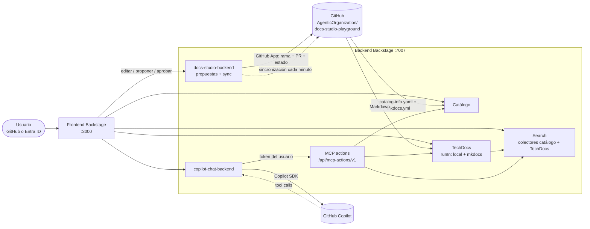

# backstage-copilot-docs-poc

Prueba de concepto de un portal de desarrolladores con [Backstage](https://backstage.io) que:

1. **Publica como TechDocs** la documentación de un equipo (handbooks en Markdown con MkDocs) alojada en un repositorio de GitHub: el _playground_ [`AgenticOrganization/docs-studio-playground`](https://github.com/AgenticOrganization/docs-studio-playground) (privado), con los handbooks `engineering-handbook` y `security-handbook`. Se registra en el catálogo con una _location_ de tipo URL.
2. **Indexa esa documentación en Search** (colectores de catálogo y de TechDocs).
3. **Añade un chat con el GitHub Copilot SDK** que responde preguntas sobre el handbook usando las _MCP actions_ de Backstage (`search.query`, acciones de catálogo y de TechDocs) y **cita la página de origen**.
4. **Permite leer y editar esa documentación desde Backstage sin cuenta de GitHub** con **Docs Studio**: personas que solo tienen Microsoft Entra ID pueden leer TechDocs según sus permisos, editar páginas, proponer cambios y crear páginas nuevas. Una GitHub App convierte cada propuesta en una rama y una _pull request_, y la aprobación se hace en Backstage (ver [Docs Studio](#docs-studio)).

## Arquitectura



- `plugins/copilot-chat`: página de chat del frontend (nuevo _frontend system_), con selector de modelo y sugerencias.
- `plugins/copilot-chat-backend`: endpoint SSE `/api/copilot-chat/chat` que crea una sesión del Copilot SDK con el token de GitHub del usuario y le da como herramientas las _MCP actions_ de Backstage.
- `plugins/docs-studio`, `plugins/docs-studio-backend` y `plugins/docs-studio-common`: Docs Studio (ver [Docs Studio](#docs-studio)).
- `packages/backend/src/modules/techdocsRootIndex.ts`: genera una página de inicio de TechDocs cuando el `docs_dir` del repositorio de documentación no tiene `index.md`.
- `packages/backend/src/modules/docsStudioPolicy.ts` y `docsStudioCatalogRules.ts`: política de permisos de ejemplo de la aplicación (lectura de entidades restringidas y aprobación de propuestas).

## Docs Studio

Docs Studio es un conjunto de plugins de Backstage que permite **leer, editar, proponer cambios y crear páginas** de TechDocs a personas que **no tienen cuenta ni licencia de GitHub** (inician sesión con Microsoft Entra ID). Una **GitHub App** convierte cada propuesta en una rama y una _pull request_; el autor del commit es el usuario de Backstage y el _committer_ es el bot de la App.

| Paquete                                                                | Contenido                                                                            |
| ---------------------------------------------------------------------- | ------------------------------------------------------------------------------------ |
| [`plugins/docs-studio`](plugins/docs-studio/README.md)                 | Frontend: addons de TechDocs, editor Markdown/WYSIWYG, lista y detalle de propuestas |
| [`plugins/docs-studio-backend`](plugins/docs-studio-backend/README.md) | Backend: API REST, GitHub App, propuestas, aprobación, merge y sincronización        |
| [`plugins/docs-studio-common`](plugins/docs-studio-common/README.md)   | Permisos, anotaciones y tipos compartidos                                            |

### Dos personas

|                               | Con licencia (GHEC/EMU)                                                                             | Sin licencia (solo Entra ID)                                              |
| ----------------------------- | --------------------------------------------------------------------------------------------------- | ------------------------------------------------------------------------- |
| Cuenta de GitHub              | Sí, con licencia                                                                                    | No                                                                        |
| Entidad `User` en el catálogo | Tiene la anotación `github.com/user-login`                                                          | No la tiene; se identifica por `graph.microsoft.com/user-id` o por correo |
| Leer TechDocs                 | Sí, según sus permisos                                                                              | Sí, según sus permisos                                                    |
| Editar, proponer y crear      | Desde Backstage, o abriendo la PR directamente en GitHub (la sincronización la importa a Backstage) | Solo desde Backstage                                                      |
| Enlaces «Ver en GitHub»       | Sí                                                                                                  | No                                                                        |
| Chat de Copilot               | Sí (inicio de sesión con GitHub)                                                                    | Deshabilitado (BYOK es un siguiente paso)                                 |

### Cómo funciona una propuesta

1. La persona edita una página (o crea una nueva) desde la barra de TechDocs y envía la propuesta. Solo hay **una propuesta abierta por página**: un segundo editor se une a ella y queda como `Co-authored-by`. Los conflictos se detectan con el SHA del archivo y se devuelven como 409 con el contenido actual.
2. El backend crea con la GitHub App una rama (prefijo `docs-studio`) y una PR contra la rama por defecto.
3. Una persona con el permiso `docs-studio.proposal.approve` (propietario de la entidad o listada en la anotación `docs-studio/approvers`) la aprueba en Backstage. Rige la regla de los cuatro ojos: nadie aprueba su propia propuesta.
4. La aprobación publica el _commit status_ `docs-studio/approval` sobre el SHA aprobado (se invalida si la rama avanza). Un **ruleset** del repositorio exige ese estado, publicado solo por la App y sin _bypass_.
5. La PR se fusiona con _merge commit_ (no _squash_) anclado al SHA aprobado y TechDocs reconstruye la documentación.

Las entidades con la anotación `docs-studio/visibility: restricted` solo las pueden leer (catálogo, TechDocs y búsqueda) y proponer sus propietarios. Esa regla vive en la política de permisos de la aplicación ([`docsStudioPolicy.ts`](packages/backend/src/modules/docsStudioPolicy.ts)); el plugin solo define los permisos.

La tarea programada `docs-studio-sync` se ejecuta cada minuto (en local no hay _webhooks_): refresca el estado de las propuestas e importa las PR abiertas directamente en GitHub.

### Puesta en marcha

Los pasos detallados, con los comandos de cada script, están en [`scripts/docs-studio/README.md`](scripts/docs-studio/README.md). Los scripts que cambian algo son _dry-run_ por defecto y necesitan `--apply`.

1. (Opcional) Identificar usuarios de Entra sin licencia: `list-entra-unlicensed.mjs` (solo lectura).
2. Generar el contenido del repositorio de documentación: `seed-playground.mjs`.
3. Crear el repositorio privado `AgenticOrganization/docs-studio-playground` y subir el contenido.
4. Crear la GitHub App (`create-github-app.mjs`) e instalarla **solo** en el repositorio del playground.
5. Aplicar el ruleset que exige el estado `docs-studio/approval` (`apply-ruleset.mjs`).
6. Configurar Backstage: `app-config.local.yaml`, `.env` y `examples/docs-studio/org.local.yaml`, y arrancar con `./scripts/start.sh`.

### Ficheros con identidades locales

Estos ficheros contienen identificadores y credenciales reales de tu entorno. **Están en `.gitignore`: no los subas al repositorio.**

| Fichero                                   | Qué contiene                                                                                                                                  |
| ----------------------------------------- | --------------------------------------------------------------------------------------------------------------------------------------------- |
| `examples/docs-studio/org.local.yaml`     | Usuarios y grupos de Docs Studio (identificadores de Entra, correos, usuarios de GitHub). Lo crea `scripts/start.sh` desde `org.example.yaml` |
| `app-config.local.yaml`                   | Copia de `app-config.local.example.yaml`: repite el bloque `integrations.github` y añade la GitHub App                                        |
| `.env`                                    | `GITHUB_TOKEN`, `AUTH_GITHUB_*` y `AUTH_MICROSOFT_*`                                                                                          |
| `github-app-docs-studio-credentials.yaml` | Credenciales de la GitHub App (las genera `create-github-app.mjs`, modo 0600)                                                                 |

También se ignora `.docs-studio-data`, la base de datos SQLite local donde se guardan las propuestas.

## Versiones

| Componente                  | Versión                          |
| --------------------------- | -------------------------------- |
| Backstage                   | 1.56.0 (nuevo _frontend system_) |
| Node.js                     | 24                               |
| Yarn                        | 4.13.0                           |
| `@github/copilot-sdk`       | 1.0.29                           |
| Modelo por defecto del chat | `claude-haiku-4.5`               |

## Requisitos previos

1. **GitHub OAuth App** para el inicio de sesión con GitHub (el chat necesita la identidad de GitHub del usuario):
   - Homepage URL: `http://localhost:3000`
   - Authorization callback URL: `http://localhost:7007/api/auth/github/handler/frame`
2. **App registration de Microsoft Entra ID** (un solo _tenant_) para el inicio de sesión de las personas sin cuenta de GitHub:
   - Redirect URI (tipo _Web_): `http://localhost:7007/api/auth/microsoft/handler/frame`
   - El inicio de sesión es estricto: cada persona necesita una entidad `User` en el catálogo, que se enlaza por `graph.microsoft.com/user-id` o por correo (`spec.profile.email`).
3. **Token de GitHub** con acceso de solo lectura (_Contents_) al repositorio de documentación (`AgenticOrganization/docs-studio-playground`).
4. **GitHub App de Docs Studio**, instalada solo en ese repositorio, para crear ramas, commits, _pull requests_ y estados (la crea `scripts/docs-studio/create-github-app.mjs`; ver [Docs Studio](#docs-studio)).
5. **Licencia de GitHub Copilot** para el usuario que quiera usar el chat.
6. **Python + mkdocs-techdocs-core** para generar TechDocs en local (no se usa Docker):

   ```bash
   python3 -m venv ~/.venvs/techdocs
   ~/.venvs/techdocs/bin/pip install mkdocs-techdocs-core
   # Si PyPI está bloqueado en tu red, usa el proxy:
   # ~/.venvs/techdocs/bin/pip install --index-url https://packagefeedproxy.microsoft.io/pypi/simple/ mkdocs-techdocs-core
   ```

7. Los usuarios deben existir en el catálogo: `examples/org.yaml` incluye `0gis0` (inicio de sesión con GitHub; si usas otra cuenta, añade un `User` con el nombre de tu usuario de GitHub en minúsculas) y `examples/docs-studio/org.local.yaml` contiene las personas de Docs Studio.

## Configuración

```bash
cp .env.example .env
cp app-config.local.example.yaml app-config.local.yaml
```

Rellena las variables (nunca subas `.env` ni `app-config.local.yaml` al repositorio):

| Variable                                                    | Uso                                                                                    |
| ----------------------------------------------------------- | -------------------------------------------------------------------------------------- |
| `GITHUB_TOKEN`                                              | Lectura del repositorio privado de documentación                                       |
| `AUTH_GITHUB_CLIENT_ID` / `AUTH_GITHUB_CLIENT_SECRET`       | OAuth App para el inicio de sesión con GitHub                                          |
| `AUTH_MICROSOFT_CLIENT_ID` / `AUTH_MICROSOFT_CLIENT_SECRET` | App registration de Entra ID para el inicio de sesión con Microsoft                    |
| `AUTH_MICROSOFT_TENANT_ID`                                  | _Tenant_ de Entra ID (déjalas vacías para arrancar sin inicio de sesión con Microsoft) |
| `TECHDOCS_VENV` (opcional)                                  | Ruta del venv con mkdocs (por defecto `~/.venvs/techdocs`)                             |

`app-config.local.yaml` añade la GitHub App de Docs Studio a `integrations.github` (los arrays de configuración se reemplazan, no se combinan, así que el bloque se repite completo). Las credenciales de la App van en `github-app-docs-studio-credentials.yaml`.

Si tu red necesita un proxy de npm, instala las dependencias con él:

```bash
YARN_NPM_REGISTRY_SERVER=https://packagefeedproxy.microsoft.io/npm/ yarn install
```

## Arrancar

```bash
yarn install
./scripts/start.sh
```

`scripts/start.sh` carga `.env`, crea `examples/docs-studio/org.local.yaml` a partir de `org.example.yaml` si no existe (sustituye los valores `REPLACE_ME`), añade el venv de mkdocs al `PATH` y ejecuta `yarn start`. Abre <http://localhost:3000> e inicia sesión con **Microsoft** (Docs Studio), con **GitHub** (el chat lo necesita) o como **Guest** (catálogo, TechDocs y búsqueda).

Validaciones:

```bash
yarn tsc
yarn lint:all
CI=true yarn test
yarn build:backend
```

## Guion de la demo

Entidades del repositorio [`AgenticOrganization/docs-studio-playground`](https://github.com/AgenticOrganization/docs-studio-playground): `engineering-handbook` (propietario y aprobadores: grupo `handbook-approvers`) y `security-handbook` (restringido: solo lo ve el equipo de seguridad). Personas de ejemplo (en `examples/docs-studio/org.local.yaml` se sustituyen por las cuentas reales de tu entorno):

| Persona       | Perfil                                              | Rol en la demo                                   |
| ------------- | --------------------------------------------------- | ------------------------------------------------ |
| Jon Snow      | Con licencia de GitHub, grupo `engineering`         | Propone un cambio desde GitHub o desde Backstage |
| Samwell Tarly | Con licencia de GitHub, grupo `handbook-approvers`  | Aprueba                                          |
| Arya          | Sin licencia (solo Entra ID), grupo `engineering`   | Lee, edita y propone solo desde Backstage        |
| Sansa         | Sin licencia (solo Entra ID), grupo `security-team` | Ve la sección restringida                        |

1. **Catálogo**: abre `engineering-handbook`. Viene del repositorio de documentación a través de su `catalog-info.yaml`.
2. **Leer**: pestaña _Docs_ → _Platform Operations_ → _Deployment Guide_ → _Rollback Procedure_. La primera vez la generación tarda unos segundos. Inicia sesión con Microsoft como **Arya** (sin cuenta de GitHub): puede leer, pero no ve enlaces «Ver en GitHub» ni puede usar el chat.
3. **Editar y proponer**: como Arya, pulsa el botón de editar de la barra de TechDocs, cambia un paso del procedimiento y envía la propuesta. En Docs Studio (lista de propuestas) aparece como _Abierta_; en GitHub, la GitHub App ha creado la rama y la PR con Arya como autora del commit y el bot como _committer_. Si **Jon** (con licencia) edita la misma página, se une a la propuesta como `Co-authored-by`.
4. **Aprobar**: Arya no puede aprobar su propia propuesta (cuatro ojos). Entra como **Samwell** (propietario de `engineering-handbook`), abre la propuesta en _Pendientes de mi aprobación_, revisa los cambios y pulsa _Aprobar_. Se publica el estado `docs-studio/approval` y, como `autoMergeOnApproval` está activo, la PR se fusiona con un _merge commit_.
5. **Ver en TechDocs**: tras el merge TechDocs reconstruye la página y el cambio aparece en _Rollback Procedure_ (la sincronización puede tardar hasta un minuto). Busca `rollback` en **Search** para ver el resultado indexado.
6. **Entidad restringida**: abre `security-handbook`. Como Arya no aparece (ni en el catálogo, ni en TechDocs, ni en Search); como **Sansa** (`security-team`) sí.
7. **Copilot Chat** (con **Jon** o **Samwell**, iniciando sesión con GitHub): pregunta _What is the rollback procedure?_ o _What are the severity levels?_. El agente llama a `search.query` sobre TechDocs y responde con un apartado **Sources** que enlaza a la página de TechDocs. Con Arya el chat aparece deshabilitado.

## Limitaciones conocidas

- **Inicio de sesión con redirección**: se usa `enableExperimentalRedirectFlow` en lugar del popup de OAuth.
- **Búsqueda**: el índice está en memoria y tarda alrededor de un minuto en llenarse tras arrancar.
- **Página de inicio generada**: si el `docs_dir` de un repositorio de documentación no tiene `index.md` en la raíz, el backend genera una página de inicio con enlaces a las secciones (`techdocsRootIndex.ts`). No modifica el repositorio de origen.
- **TechDocs en local, sin Docker** (`techdocs.generator.runIn: local`).
- **Safari/WebKit en `http://localhost`**: Backstage emite la cookie `backstage-auth` como `Secure; SameSite=None` cuando el host es `localhost`. WebKit la descarta en HTTP, así que los recursos estáticos de TechDocs devuelven 401 y la página se queda cargando. Usa Chrome o Edge en local, o HTTPS.
- **MCP actions del chat**: el backend del chat llama a las MCP actions con un token emitido en nombre del usuario que ha iniciado sesión, así que la política de permisos se aplica también a lo que el asistente puede leer. `backend.actions.filter` solo expone acciones `readOnly`.
- **Chat**: requiere iniciar sesión con GitHub (no funciona como Guest) y una licencia de Copilot. Para las personas sin licencia (solo Entra ID) está **deshabilitado**; usar una clave propia (BYOK) es un siguiente paso.
- **Sección restringida en GitHub**: la restricción solo se aplica en Backstage. En GitHub, el contenido de `security-handbook` lo puede leer cualquier miembro de la organización (el permiso base de la organización es _read_).
- **Estados con retraso**: no hay _webhooks_ en local, así que los cambios hechos en GitHub (PR fusionadas o cerradas, ramas que avanzan, estados) tardan hasta 1 minuto en reflejarse en Backstage (tarea `docs-studio-sync`).
- **Commits «Verified»**: no se ha verificado que los commits creados por la GitHub App aparezcan como _Verified_ en GitHub (el backend no los firma él mismo).
- **Alertas de GFM**: las alertas de GitHub (`> [!NOTE]`, etc.) pueden verse como citas (_blockquotes_) en TechDocs, porque MkDocs no las interpreta.
