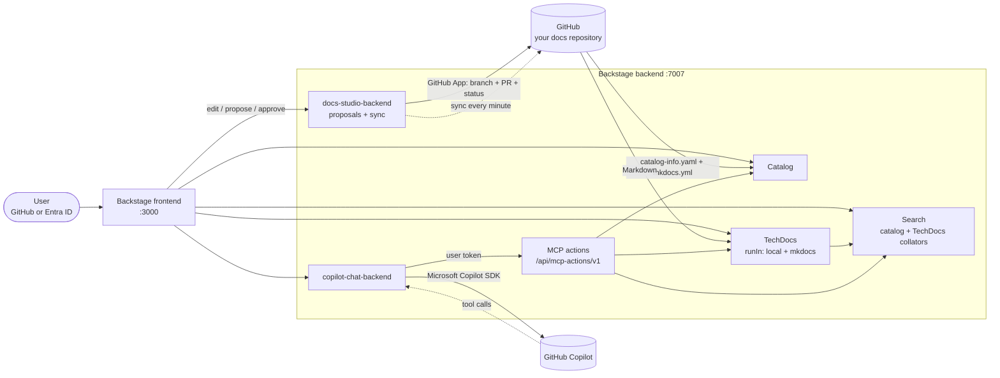

# backstage-copilot-docs-poc

Proof of concept of a developer portal built on [Backstage](https://backstage.io) that:

1. **Publishes team documentation as TechDocs.** The documentation (Markdown handbooks built with MkDocs) lives in a GitHub repository that you own, the _docs repository_. It contains two sample handbooks, `engineering-handbook` and `security-handbook`, and is registered in the catalog with a URL location. You create this repository yourself; see [Create your docs repository](#3-create-your-docs-repository).
2. **Indexes that documentation in Search** (catalog and TechDocs collators).
3. **Adds a chat built with the Microsoft Copilot SDK (formerly GitHub Copilot SDK)** that answers questions about the handbooks using Backstage's MCP actions (`search.query`, catalog and TechDocs actions) and **cites the source page**.
4. **Lets people read and edit that documentation from Backstage without a GitHub account**, with **Docs Studio**. People who only have a Microsoft Entra ID identity can read TechDocs (according to their permissions), edit pages, propose changes and create new pages. A GitHub App turns each proposal into a branch and a pull request, and approval happens in Backstage (see [Docs Studio](#docs-studio)).

> [!NOTE]
> On 28 October 2026 GitHub [announced](https://github.blog/changelog/2026-10-28-github-copilot-sdk-is-becoming-microsoft-copilot-sdk/) that the **GitHub Copilot SDK** is being renamed **Microsoft Copilot SDK**. The npm package is still `@github/copilot-sdk`.

## Contents

1. [Architecture](#architecture)
2. [Docs Studio](#docs-studio)
3. [Quick start](#quick-start)
4. [Prerequisites and setup](#prerequisites-and-setup)
   - [1. Tools](#1-tools)
   - [2. Sign-in apps](#2-sign-in-apps)
   - [3. Create your docs repository](#3-create-your-docs-repository)
   - [4. GitHub token](#4-github-token)
   - [5. Docs Studio GitHub App](#5-docs-studio-github-app)
   - [6. Python and mkdocs-techdocs-core](#6-python-and-mkdocs-techdocs-core)
   - [7. Copilot license](#7-copilot-license)
5. [Configuration reference](#configuration-reference)
6. [Users and personas in the catalog](#users-and-personas-in-the-catalog)
7. [Run and validate](#run-and-validate)
8. [Demo walkthrough](#demo-walkthrough)
9. [Dependencies and Dependabot](#dependencies-and-dependabot)
10. [Known limitations](#known-limitations)

## Architecture



Repository layout:

- `plugins/copilot-chat`: chat page of the frontend (new frontend system), with a model selector and suggestions.
- `plugins/copilot-chat-backend`: SSE endpoint `/api/copilot-chat/chat` that creates a Microsoft Copilot SDK session with the user's GitHub token and gives it Backstage's MCP actions as tools.
- `plugins/docs-studio`, `plugins/docs-studio-backend` and `plugins/docs-studio-common`: Docs Studio (see [Docs Studio](#docs-studio)).
- `packages/backend/src/modules/techdocsRootIndex.ts`: generates a TechDocs home page when the `docs_dir` of the docs repository has no `index.md`.
- `packages/backend/src/modules/docsStudioPolicy.ts` and `docsStudioCatalogRules.ts`: the application's example permission policy (reading restricted entities and approving proposals).
- `scripts/docs-studio/`: setup scripts for the docs repository, the GitHub App and the ruleset (see [its README](scripts/docs-studio/README.md)).
- `examples/`: catalog data (`org.yaml`, `entities.yaml`, a software template) and the Docs Studio personas (`examples/docs-studio/org.example.yaml`).

## Docs Studio

Docs Studio is a set of Backstage plugins that lets people who **have no GitHub account or license** (they sign in with Microsoft Entra ID) **read, edit, propose changes to and create** TechDocs pages. A **GitHub App** turns each proposal into a branch and a pull request. The commit author is the Backstage user and the committer is the App's bot.

The complete demo story (from Confluence to TechDocs), with a manual step-by-step reproduction for each persona, is in [`docs/docs-studio/demo-guide.md`](docs/docs-studio/demo-guide.md). The end-to-end flow diagram is in [`docs/docs-studio/demo-flow.md`](docs/docs-studio/demo-flow.md).

| Package                                                                | Contents                                                                     |
| ---------------------------------------------------------------------- | ---------------------------------------------------------------------------- |
| [`plugins/docs-studio`](plugins/docs-studio/README.md)                 | Frontend: TechDocs addons, Markdown/WYSIWYG editor, proposal list and detail |
| [`plugins/docs-studio-backend`](plugins/docs-studio-backend/README.md) | Backend: REST API, GitHub App, proposals, approval, merge and sync           |
| [`plugins/docs-studio-common`](plugins/docs-studio-common/README.md)   | Shared permissions, annotations and types                                    |

### Two personas

|                              | Licensed (GHEC/EMU)                                                                          | Unlicensed (Entra ID only)                                                |
| ---------------------------- | -------------------------------------------------------------------------------------------- | ------------------------------------------------------------------------- |
| GitHub account               | Yes, licensed                                                                                | No                                                                        |
| `User` entity in the catalog | Has the `github.com/user-login` annotation                                                   | Does not have it; identified by `graph.microsoft.com/user-id` or by email |
| Read TechDocs                | Yes, according to their permissions                                                          | Yes, according to their permissions                                       |
| Edit, propose and create     | From Backstage, or by opening the PR directly on GitHub (the sync imports it into Backstage) | Only from Backstage                                                       |
| "View on GitHub" links       | Yes                                                                                          | No                                                                        |
| Copilot chat                 | Yes (GitHub sign-in)                                                                         | Disabled (bring-your-own-key is a possible next step)                     |

### How a proposal works

1. The person edits a page (or creates a new one) from the TechDocs toolbar and submits the proposal. There is only **one open proposal per page**: a second editor joins it and is added as `Co-authored-by`. Conflicts are detected with the file SHA and returned as a 409 with the current content.
2. The backend uses the GitHub App to create a branch (prefix `docs-studio`) and a PR against the default branch.
3. A person with the `docs-studio.proposal.approve` permission (the entity owner, or someone listed in the `docs-studio/approvers` annotation) approves it in Backstage. The four-eyes rule applies: nobody approves their own proposal.
4. The approval publishes the `docs-studio/approval` commit status on the approved SHA (it is invalidated if the branch moves). A repository **ruleset** requires that status, which only the App can publish and which has no bypass.
5. The PR is merged with a merge commit (not squash) pinned to the approved SHA, and TechDocs rebuilds the documentation.

Entities annotated `docs-studio/visibility: restricted` can only be read (catalog, TechDocs and search) and proposed to by their owners. That rule lives in the application's permission policy ([`docsStudioPolicy.ts`](packages/backend/src/modules/docsStudioPolicy.ts)); the plugin only defines the permissions.

The scheduled task `docs-studio-sync` runs every minute (there are no webhooks locally): it refreshes the proposals' state and imports PRs that were opened directly on GitHub.

## Quick start

For people who have already done the one-off setup below:

```bash
yarn install
./scripts/start.sh
```

Open <http://localhost:3000>. The remaining sections explain how to get there from scratch.

## Prerequisites and setup

Do these in order. Everything you create stays in your own accounts; nothing here depends on the original author's organization.

### 1. Tools

| Tool    | Version                                                         |
| ------- | --------------------------------------------------------------- |
| Node.js | 22 or 24 (the `engines` field of `package.json`)                |
| Yarn    | 4.13.0 (provided by `.yarn/releases`, via Corepack or `yarn` 4) |
| Python  | 3.9 or newer, only for TechDocs generation                      |
| `gh`    | GitHub CLI, only for the Docs Studio setup scripts              |
| Git     |                                                                 |

Versions of the main components: Backstage 1.56.0 (new frontend system), `@github/copilot-sdk` 1.0.29 (Microsoft Copilot SDK), default chat model `claude-haiku-4.5`.

If your network requires a package proxy or a private registry, configure it for Yarn (`YARN_NPM_REGISTRY_SERVER` or `npmRegistryServer` in a user-level `.yarnrc.yml`) and for pip before running the install commands below.

Then install the dependencies and sign in to GitHub from the CLI (the setup scripts need an authenticated `gh` session, and pushing the docs repository creates a commit, so Git needs a name and email):

```bash
yarn install
gh auth login
git config --global user.name "Your Name"      # only if not set yet
git config --global user.email you@example.com # only if not set yet
```

### 2. Sign-in apps

1. **GitHub OAuth App** for GitHub sign-in (the chat needs the user's GitHub identity). Create it under GitHub > Settings > Developer settings > OAuth Apps:
   - Homepage URL: `http://localhost:3000`
   - Authorization callback URL: `http://localhost:7007/api/auth/github/handler/frame`
   - Put the client ID and secret in `AUTH_GITHUB_CLIENT_ID` / `AUTH_GITHUB_CLIENT_SECRET`.
2. **Microsoft Entra ID app registration** (single tenant) for people without a GitHub account. Create it in the Entra admin center > App registrations:
   - Redirect URI (platform _Web_): `http://localhost:7007/api/auth/microsoft/handler/frame`
   - Create a client secret.
   - Put the application (client) ID, the secret and the directory (tenant) ID in `AUTH_MICROSOFT_CLIENT_ID`, `AUTH_MICROSOFT_CLIENT_SECRET` and `AUTH_MICROSOFT_TENANT_ID`.
   - Sign-in is strict: each person needs a `User` entity in the catalog, matched by the `graph.microsoft.com/user-id` annotation (Entra object ID) or by `spec.profile.email`. See [Users and personas](#users-and-personas-in-the-catalog).
   - If you leave the three `AUTH_MICROSOFT_*` variables empty, Backstage still starts, without Microsoft sign-in (Guest and GitHub sign-in keep working).

GitHub sign-in is configured for a PoC: it accepts any GitHub user even without a matching `User` entity (`dangerouslyAllowSignInWithoutUserInCatalog` in `app-config.yaml`). Remove that flag for anything beyond a PoC.

### 3. Create your docs repository

The docs repository holds the TechDocs sources and is the only repository Docs Studio is allowed to write to. The scripts in `scripts/docs-studio/` generate a ready-to-use one from a public sample corpus ([`0GiS0/confluence-to-github-poc`](https://github.com/0GiS0/confluence-to-github-poc)): an engineering handbook and a restricted security handbook, each with its own `catalog-info.yaml` and `mkdocs.yml`, plus a root `catalog-info.yaml` that registers both.

```bash
# 1. Generate the content locally (dry, changes nothing on GitHub)
node scripts/docs-studio/seed-playground.mjs --out ./docs-repo-seed

# 2. Create an empty repository on GitHub. Use the SAME organization that will own
#    the GitHub App in the next step: a private App can only be installed on its owner's repositories
gh repo create <org>/<docs-repo> --private

# 3. Push the generated content (dry-run unless --apply is given)
node scripts/docs-studio/seed-playground.mjs --out ./docs-repo-seed --force \
  --push <org>/<docs-repo> --apply
```

You can use your own existing documentation instead, as long as the repository has a root `catalog-info.yaml` (a `Location` pointing to one or more `catalog-info.yaml` files with `backstage.io/techdocs-ref: dir:.` and a `mkdocs.yml`).

**Point Backstage at it** by setting a single variable in `.env`, with no need to edit any tracked file:

```bash
DOCS_STUDIO_REPOSITORY=<org>/<docs-repo>
```

`app-config.yaml` reads this variable in two places: the catalog location (`https://github.com/<owner>/<docs-repo>/blob/main/catalog-info.yaml`) and `docsStudio.allowedRepositories`. If the variable is not set, it falls back to the original demo repository `AgenticOrganization/docs-studio-playground`, which is private and unreachable for you, so always set it. `scripts/start.sh` prints a notice when it is missing.

Optionally apply the branch ruleset (rulesets on private organization repositories need a GitHub Team or Enterprise Cloud plan; without it, Docs Studio still works, but PRs opened directly on GitHub are not blocked until approved) that makes the `docs-studio/approval` status mandatory (after you have the GitHub App id, next step):

```bash
node scripts/docs-studio/apply-ruleset.mjs --repo <owner>/<docs-repo> --app-id <id>          # dry-run
node scripts/docs-studio/apply-ruleset.mjs --repo <owner>/<docs-repo> --app-id <id> --apply
```

The sample handbooks are owned by the groups `handbook-approvers` and `security-team`, which must exist in the catalog (they are included in `examples/docs-studio/org.example.yaml`).

### 4. GitHub token

Create a fine-grained personal access token with **read-only "Contents"** access to your docs repository and put it in `GITHUB_TOKEN`. Backstage uses it to read the catalog files and the Markdown. Writes (Docs Studio proposals) use the GitHub App instead.

### 5. Docs Studio GitHub App

The App creates branches, commits, pull requests and commit statuses (permissions `contents:write`, `pull_requests:write`, `statuses:write`, `metadata:read`; no webhooks).

```bash
node scripts/docs-studio/create-github-app.mjs --org <org>          # dry-run: prints the manifest
node scripts/docs-studio/create-github-app.mjs --org <org> --apply  # opens GitHub to confirm
```

The script writes `github-app-docs-studio-credentials.yaml` (gitignored, mode 0600). Then:

1. Install the App **only on your docs repository** (the script prints the URL).
2. Copy the local config template: `cp app-config.local.example.yaml app-config.local.yaml`. It includes the credentials file.

Even if the App is installed on more repositories, Docs Studio only acts on those listed in `docsStudio.allowedRepositories` (which is `DOCS_STUDIO_REPOSITORY`).

### 6. Python and mkdocs-techdocs-core

TechDocs is generated locally, without Docker (`techdocs.generator.runIn: local`):

```bash
python3 -m venv ~/.venvs/techdocs
~/.venvs/techdocs/bin/pip install mkdocs-techdocs-core
```

If your network requires a package proxy or a private index, pass it to `pip` (`--index-url`, or `PIP_INDEX_URL`). `scripts/start.sh` adds the venv to `PATH`; use `TECHDOCS_VENV` if you create it somewhere else.

### 7. Copilot license

The chat needs a GitHub account with a **GitHub Copilot license**. The rest of the PoC does not.

## Configuration reference

Create these files once, at the start of setup, and only if they do not exist yet (copying again would erase the values you entered):

```bash
[ -f .env ] || cp .env.example .env
[ -f app-config.local.yaml ] || cp app-config.local.example.yaml app-config.local.yaml
```

Never commit `.env` or `app-config.local.yaml`.

### Environment variables (`.env`)

| Variable                                                    | Purpose                                                                                       |
| ----------------------------------------------------------- | --------------------------------------------------------------------------------------------- |
| `DOCS_STUDIO_REPOSITORY`                                    | `owner/name` of your docs repository (catalog location and Docs Studio allow-list)            |
| `GITHUB_TOKEN`                                              | Read access to the docs repository                                                            |
| `AUTH_GITHUB_CLIENT_ID` / `AUTH_GITHUB_CLIENT_SECRET`       | OAuth App for GitHub sign-in                                                                  |
| `AUTH_MICROSOFT_CLIENT_ID` / `AUTH_MICROSOFT_CLIENT_SECRET` | Entra ID app registration for Microsoft sign-in                                               |
| `AUTH_MICROSOFT_TENANT_ID`                                  | Entra ID tenant (leave the three `AUTH_MICROSOFT_*` empty to start without Microsoft sign-in) |
| `TECHDOCS_VENV` (optional)                                  | Path of the venv with mkdocs (default `~/.venvs/techdocs`)                                    |

### Files

| File                                      | Tracked | Purpose                                                                                                                                                                         |
| ----------------------------------------- | ------- | ------------------------------------------------------------------------------------------------------------------------------------------------------------------------------- |
| `app-config.yaml`                         | yes     | Base configuration. The `docsStudio` block (approvals, auto-merge, branch prefix, sync frequency), `copilotChat` (default model, docs entity) and `catalog.locations` live here |
| `app-config.production.yaml`              | yes     | Production overrides (PostgreSQL)                                                                                                                                               |
| `app-config.local.example.yaml`           | yes     | Template for `app-config.local.yaml`                                                                                                                                            |
| `app-config.local.yaml`                   | no      | Your copy. Repeats the `integrations.github` block (arrays are replaced, not merged) and adds the GitHub App                                                                    |
| `github-app-docs-studio-credentials.yaml` | no      | GitHub App credentials, generated by `create-github-app.mjs` (mode 0600)                                                                                                        |
| `.env`                                    | no      | The variables above                                                                                                                                                             |
| `examples/docs-studio/org.local.yaml`     | no      | Your personas; created by `scripts/start.sh` from `org.example.yaml`                                                                                                            |
| `.docs-studio-data/`                      | no      | Local SQLite database with the proposals                                                                                                                                        |

`copilotChat.docsEntity` (default `default/component/engineering-handbook`) is the entity whose TechDocs the assistant cites. Change it if your docs repository uses other entity names.

## Users and personas in the catalog

Docs Studio needs `User` and `Group` entities. Two files provide them:

- `examples/org.yaml`: the `guest` user and a sample user named `0gis0` (the repository owner's GitHub login). To sign in with GitHub as someone else, add a `User` whose `metadata.name` is your lowercase GitHub login, for example:

  ```yaml
  apiVersion: backstage.io/v1alpha1
  kind: User
  metadata:
    name: your-github-login
    annotations:
      github.com/user-login: your-github-login
  spec:
    profile:
      displayName: Your Name
    memberOf: [guests]
  ```

  To use the Copilot chat, the `User` also needs the annotation `github.com/user-login: your-github-login` (under `metadata.annotations`) **and** the account needs a real GitHub Copilot license. Docs Studio treats the annotation as "has a Copilot license".

- `examples/docs-studio/org.local.yaml` (gitignored): the Docs Studio personas. `scripts/start.sh` creates it from the committed `org.example.yaml` the first time. Replace every `REPLACE_ME` value:

  | Field                         | What to set                                                                                               |
  | ----------------------------- | --------------------------------------------------------------------------------------------------------- |
  | `metadata.name`               | The GitHub login for licensed users (so GitHub sign-in maps to the same entity); any valid name otherwise |
  | `graph.microsoft.com/user-id` | Entra object ID (`az ad user show --id <upn> --query id -o tsv`). Matched first by Microsoft sign-in      |
  | `spec.profile.email`          | The Entra `mail`, or the userPrincipalName when `mail` is empty. Matched second                           |
  | `github.com/user-login`       | **Only for licensed users.** Its presence is what Docs Studio treats as "has a GitHub Copilot license"    |

  The file defines four personas (two licensed, two unlicensed) and three groups: `engineering`, `handbook-approvers` (owner and approvers of the Engineering Handbook) and `security-team` (the only group that can read the restricted Security Handbook). To add your own people, copy a `User` block and set `memberOf` to the group that matches their role. `scripts/docs-studio/list-entra-unlicensed.mjs` (read-only, uses `az`) helps find Entra users that have no GitHub license.

## Run and validate

```bash
yarn install
./scripts/start.sh
```

`scripts/start.sh` loads `.env`, creates `examples/docs-studio/org.local.yaml` if it is missing, adds the mkdocs venv to `PATH` and runs `yarn start`. Open <http://localhost:3000> and sign in with **Microsoft** (Docs Studio), **GitHub** (the chat needs it) or as **Guest** (catalog, TechDocs and search). Backstage uses ports 3000 (frontend) and 7007 (backend).

Checks:

```bash
yarn tsc
yarn lint:all
CI=true yarn test
yarn build:backend
```

To verify that the docs repository is picked up, open the catalog: `engineering-handbook` and `security-handbook` should appear (the catalog refreshes in about a minute), and the _Docs_ tab of `engineering-handbook` should render.

## Demo walkthrough

The sample entities are `engineering-handbook` (owner and approvers: group `handbook-approvers`) and `security-handbook` (restricted: only the security team sees it). The personas below are the ones in `examples/docs-studio/org.example.yaml`; replace them with real accounts of your environment.

| Persona       | Profile                                           | Role in the demo                                |
| ------------- | ------------------------------------------------- | ----------------------------------------------- |
| Jon Snow      | GitHub license, group `engineering`               | Proposes a change from GitHub or from Backstage |
| Samwell Tarly | GitHub license, group `handbook-approvers`        | Approves                                        |
| Arya          | Unlicensed (Entra ID only), group `engineering`   | Reads, edits and proposes only from Backstage   |
| Sansa         | Unlicensed (Entra ID only), group `security-team` | Sees the restricted section                     |

1. **Catalog**: open `engineering-handbook`. It comes from the docs repository through its `catalog-info.yaml`.
2. **Read**: _Docs_ tab > _Platform Operations_ > _Deployment Guide_ > _Rollback Procedure_. The first time, generation takes a few seconds. Sign in with Microsoft as **Arya** (no GitHub account): she can read, but sees no "View on GitHub" links and cannot use the chat.
3. **Edit and propose**: as Arya, click the edit button in the TechDocs toolbar, change a step of the procedure and submit. In Docs Studio (proposal list) it shows as _Open_; on GitHub, the GitHub App has created the branch and PR with Arya as commit author and the bot as committer. If **Jon** (licensed) edits the same page, he joins the proposal as `Co-authored-by`.
4. **Approve**: Arya cannot approve her own proposal (four eyes). Sign in as **Samwell** (owner of `engineering-handbook`), open the proposal under _Pending my approval_, review the changes and click _Approve_. The `docs-studio/approval` status is published and, because `autoMergeOnApproval` is on, the PR is merged with a merge commit.
5. **See it in TechDocs**: after the merge TechDocs rebuilds the page and the change appears in _Rollback Procedure_ (the sync can take up to a minute). Search for `rollback` in **Search** to see the indexed result.
6. **Restricted entity**: open `security-handbook`. As Arya it does not appear (not in the catalog, TechDocs or Search); as **Sansa** (`security-team`) it does.
7. **Copilot chat** (with **Jon**, who signs in with Microsoft and connects his GitHub account from the chat the first time): ask _What is the rollback procedure?_ or _What are the severity levels?_. The agent calls `search.query` over TechDocs and answers with a **Sources** section linking to the TechDocs page. For Arya the chat is disabled.

## Dependencies and Dependabot

Dependabot is configured in `.github/dependabot.yml` and checks dependencies every Monday at 06:00 (Madrid time):

- `npm` at the root: covers all Yarn 4 workspaces (`packages/*` and `plugins/*`) through `yarn.lock`.
- `docker`: the base image of `packages/backend/Dockerfile`.

Updates are grouped to reduce the number of PRs:

| Group             | What it includes                                                  |
| ----------------- | ----------------------------------------------------------------- |
| `backstage`       | All `@backstage/*` packages in a single PR                        |
| `npm-minor-patch` | Minor and patch versions of the other dependencies                |
| `security`        | Security updates, grouped                                         |
| No group          | Major versions of non-Backstage packages arrive as individual PRs |

PRs carry the `📦 dependencies` label and commits use `chore(deps): …` or `chore(deps-dev): …`.

There is a 3-day `cooldown` for version updates, aligned with `npmMinimalAgeGate: 3d` in `.yarnrc.yml` (Dependabot does not read that option; see [dependabot-core#14134](https://github.com/dependabot/dependabot-core/issues/14134)). Security updates do not wait.

Upgrading Backstage as a whole needs more than the grouped PR, which only changes package versions. A full upgrade (including `backstage.json` and template changes) is done with:

```bash
yarn backstage-cli versions:bump
```

Many security alerts do not produce a PR because Backstage pins vulnerable transitive dependencies (for example `@backstage/cli` → `undici`) and Dependabot reports `security_update_not_possible`. They are fixed when Backstage is upgraded.

The `node:24-trixie-slim` image is pinned by digest. Dependabot opens PRs when the digest changes (Node and OS patches). Node major versions are ignored because they must change together with `engines` in `package.json` and the host's Node version.

To dismiss a specific update, comment `@dependabot ignore this major version` (or `@dependabot ignore this minor version` / `@dependabot ignore this dependency`) on the PR.

## Known limitations

- **Redirect sign-in**: `enableExperimentalRedirectFlow` is used instead of the OAuth popup.
- **Search**: the index is in memory and takes about a minute to fill after startup.
- **Generated home page**: if the `docs_dir` of a docs repository has no `index.md` at its root, the backend generates a home page with links to the sections (`techdocsRootIndex.ts`). It does not modify the source repository.
- **TechDocs runs locally, without Docker** (`techdocs.generator.runIn: local`), so Python and `mkdocs-techdocs-core` are required on the host.
- **Safari/WebKit on `http://localhost`**: Backstage sets the `backstage-auth` cookie as `Secure; SameSite=None` when the host is `localhost`. WebKit drops it over HTTP, so TechDocs static assets return 401 and the page keeps loading. Use Chrome or Edge locally, or HTTPS.
- **Chat MCP actions**: the chat backend calls MCP actions with a token issued on behalf of the signed-in user, so the permission policy also applies to what the assistant can read. `backend.actions.filter` only exposes `readOnly` actions.
- **Chat**: requires a connected GitHub account (GitHub sign-in, or connecting one from the chat after signing in with Microsoft; it does not work as Guest) and a Copilot license. It is **disabled** for unlicensed people (Entra ID only); bring-your-own-key is a possible next step.
- **Restricted section on GitHub**: the restriction is only enforced in Backstage. On GitHub, anyone who can read the docs repository can read `security-handbook` (for example every organization member when the organization's base permission is _read_). Put restricted content in a separate repository for real isolation.
- **Delayed state**: there are no webhooks locally, so changes made on GitHub (merged or closed PRs, branches that move, statuses) take up to 1 minute to show in Backstage (`docs-studio-sync` task).
- **Unsigned commits**: commits created by the GitHub App with the Backstage person as author are **unsigned** on GitHub. Commits made in GitHub's web editor are _Verified_. If your organization requires signed commits, this path needs a different design.
- **GFM alerts**: GitHub alerts (`> [!NOTE]`, etc.) may render as blockquotes in TechDocs, because MkDocs does not interpret them.
- **Local-only setup**: the OAuth callback URLs and `baseUrl` values are `localhost`. Deploying elsewhere means changing them in `app-config.yaml`, the OAuth App and the Entra registration, and using `app-config.production.yaml`.
