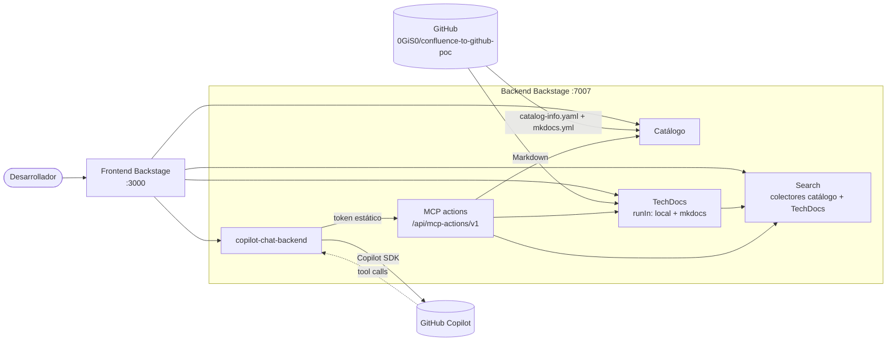

# backstage-copilot-docs-poc

Prueba de concepto de un portal de desarrolladores con [Backstage](https://backstage.io) que:

1. **Publica como TechDocs** la documentación de un equipo migrada de Confluence a Markdown y alojada en otro repositorio de GitHub ([`0GiS0/confluence-to-github-poc`](https://github.com/0GiS0/confluence-to-github-poc), privado). Ese repositorio no se modifica: se registra en el catálogo con una _location_ de tipo URL.
2. **Indexa esa documentación en Search** (colectores de catálogo y de TechDocs).
3. **Añade un chat con el GitHub Copilot SDK** que responde preguntas sobre el handbook usando las _MCP actions_ de Backstage (`search.query`, acciones de catálogo y de TechDocs) y **cita la página de origen**.

## Arquitectura



- `plugins/copilot-chat`: página de chat del frontend (nuevo _frontend system_), con selector de modelo y sugerencias.
- `plugins/copilot-chat-backend`: endpoint SSE `/api/copilot-chat/chat` que crea una sesión del Copilot SDK con el token de GitHub del usuario y le da como herramientas las _MCP actions_ de Backstage.
- `packages/backend/src/modules/techdocsRootIndex.ts`: genera una página de inicio de TechDocs cuando el `docs_dir` del repositorio de documentación no tiene `index.md`.

## Versiones

| Componente                  | Versión                          |
| --------------------------- | -------------------------------- |
| Backstage                   | 1.56.0 (nuevo _frontend system_) |
| Node.js                     | 24                               |
| Yarn                        | 4.13.0                           |
| `@github/copilot-sdk`       | 1.0.29                           |
| Modelo por defecto del chat | `claude-haiku-4.5`               |

## Requisitos previos

1. **GitHub OAuth App** para el inicio de sesión (el chat necesita la identidad de GitHub del usuario):
   - Homepage URL: `http://localhost:3000`
   - Authorization callback URL: `http://localhost:7007/api/auth/github/handler/frame`
2. **Token de GitHub** con acceso de solo lectura (_Contents_) al repositorio de documentación.
3. **Licencia de GitHub Copilot** para el usuario que inicia sesión.
4. **Python + mkdocs-techdocs-core** para generar TechDocs en local (no se usa Docker):

   ```bash
   python3 -m venv ~/.venvs/techdocs
   ~/.venvs/techdocs/bin/pip install mkdocs-techdocs-core
   # Si PyPI está bloqueado en tu red, usa el proxy:
   # ~/.venvs/techdocs/bin/pip install --index-url https://packagefeedproxy.microsoft.io/pypi/simple/ mkdocs-techdocs-core
   ```

5. El usuario de GitHub debe existir en el catálogo: `examples/org.yaml` incluye `0gis0`. Si usas otra cuenta, añade un `User` con el nombre de tu usuario de GitHub (en minúsculas).

## Configuración

```bash
cp .env.example .env
```

Rellena las variables (nunca subas `.env` al repositorio):

| Variable                                              | Uso                                                                                                                                                  |
| ----------------------------------------------------- | ---------------------------------------------------------------------------------------------------------------------------------------------------- |
| `GITHUB_TOKEN`                                        | Lectura del repositorio privado de documentación                                                                                                     |
| `AUTH_GITHUB_CLIENT_ID` / `AUTH_GITHUB_CLIENT_SECRET` | OAuth App para el inicio de sesión con GitHub                                                                                                        |
| `BACKSTAGE_MCP_ACTIONS_TOKEN`                         | Token estático con el que el backend del chat llama a las MCP actions. Genéralo con `node -p 'require("crypto").randomBytes(24).toString("base64")'` |
| `TECHDOCS_VENV` (opcional)                            | Ruta del venv con mkdocs (por defecto `~/.venvs/techdocs`)                                                                                           |

Si tu red necesita un proxy de npm, instala las dependencias con él:

```bash
YARN_NPM_REGISTRY_SERVER=https://packagefeedproxy.microsoft.io/npm/ yarn install
```

## Arrancar

```bash
yarn install
./scripts/start.sh
```

`scripts/start.sh` carga `.env`, añade el venv de mkdocs al `PATH` y ejecuta `yarn start`. Abre <http://localhost:3000> e inicia sesión con **GitHub** (el chat lo necesita) o como **Guest** (catálogo, TechDocs y búsqueda).

Validaciones:

```bash
yarn tsc
yarn lint:all
CI=true yarn test
yarn build:backend
```

## Guion de la demo

1. **Catálogo**: abre el componente `engineering-handbook-confluence-poc`. Viene del repositorio de documentación a través de su `catalog-info.yaml`.
2. **TechDocs**: pestaña _Docs_ → _Platform Operations_ → _Deployment Guide_ → _Rollback Procedure_. La primera vez la generación tarda unos segundos.
3. **Search**: busca `rollback`. Los resultados de TechDocs aparecen cuando el colector ha indexado (se ejecuta cada minuto).
4. **Copilot Chat**: pregunta _What is the rollback procedure?_ o _What are the severity levels?_. El agente llama a `search.query` sobre TechDocs y responde con un apartado **Sources** que enlaza a la página de TechDocs.

## Dependencias y Dependabot

Dependabot está configurado en `.github/dependabot.yml` y revisa las dependencias cada lunes a las 06:00 (hora de Madrid):

- `npm` en la raíz: cubre todos los workspaces de Yarn 4 (`packages/*` y `plugins/*`) a través de `yarn.lock`.
- `docker`: la imagen base de `packages/backend/Dockerfile`.

Las actualizaciones se agrupan para reducir el número de PRs:

| Grupo             | Qué incluye                                                              |
| ----------------- | ------------------------------------------------------------------------ |
| `backstage`       | Todos los paquetes `@backstage/*` en una única PR                        |
| `npm-minor-patch` | Versiones minor y patch del resto de dependencias                        |
| `security`        | Actualizaciones de seguridad, agrupadas                                  |
| Sin grupo         | Las major de paquetes que no son de Backstage llegan en PRs individuales |

Las PRs llevan la etiqueta `📦 dependencies` y los commits usan `chore(deps): …` o `chore(deps-dev): …`.

Hay un `cooldown` de 3 días para las actualizaciones de versión, alineado con `npmMinimalAgeGate: 3d` de `.yarnrc.yml` (Dependabot no lee esa opción; ver [dependabot-core#14134](https://github.com/dependabot/dependabot-core/issues/14134)). Las actualizaciones de seguridad no esperan.

Para subir Backstage completo no basta con la PR agrupada, porque solo cambia versiones de paquetes. Una subida completa (incluye `backstage.json` y cambios de plantilla) se hace con:

```bash
yarn backstage-cli versions:bump
```

Muchas alertas de seguridad no generan PR porque Backstage fija dependencias transitivas vulnerables (por ejemplo, `@backstage/cli` → `undici`) y Dependabot marca `security_update_not_possible`. Se corrigen al subir la versión de Backstage.

La imagen `node:24-trixie-slim` va fijada por digest. Dependabot abre PRs cuando cambia el digest (parches de Node y del sistema). Las versiones major de Node se ignoran porque deben cambiar a la vez que `engines` en `package.json` y que la versión de Node del host.

Para descartar una actualización concreta, comenta en la PR `@dependabot ignore this major version` (o `@dependabot ignore this minor version` / `@dependabot ignore this dependency`).

## Limitaciones conocidas

- **Inicio de sesión con redirección**: se usa `enableExperimentalRedirectFlow` en lugar del popup de OAuth.
- **Búsqueda**: el índice está en memoria y tarda alrededor de un minuto en llenarse tras arrancar.
- **Página de inicio generada**: el repositorio de documentación no tiene `index.md` en la raíz de `docs_dir`, así que el backend genera una página de inicio con enlaces a las secciones. No se modifica el repositorio de origen.
- **TechDocs en local, sin Docker** (`techdocs.generator.runIn: local`).
- **Safari/WebKit en `http://localhost`**: Backstage emite la cookie `backstage-auth` como `Secure; SameSite=None` cuando el host es `localhost`. WebKit la descarta en HTTP, así que los recursos estáticos de TechDocs devuelven 401 y la página se queda cargando. Usa Chrome o Edge en local, o HTTPS.
- **Token de las MCP actions**: está limitado a los plugins `mcp-actions`, `catalog`, `search` y `techdocs`, y `backend.actions.filter` solo expone acciones `readOnly`. Backstage no permite delegar a través de `mcp-actions` un token con restricciones de permisos, así que quien tenga el token puede seguir escribiendo directamente en la API REST del catálogo. Trátalo como un secreto de backend (no llega al navegador).
- **Chat**: requiere iniciar sesión con GitHub (no funciona como Guest) y una licencia de Copilot.
