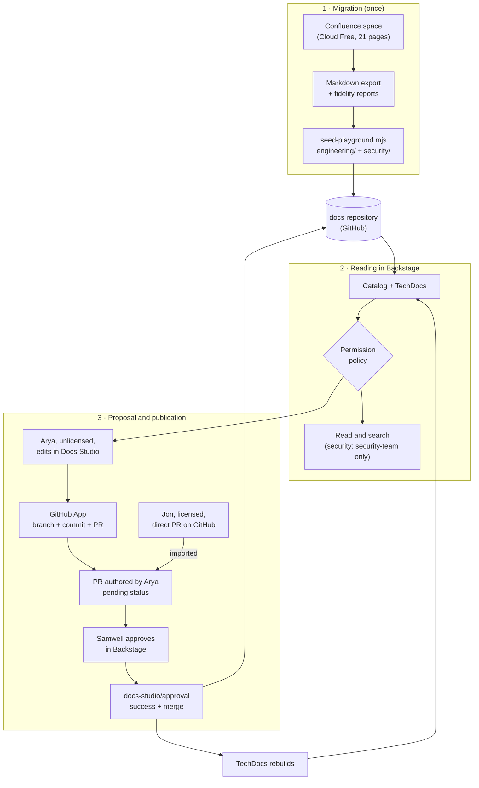

# Docs Studio: end-to-end demo flow

This diagram accompanies the [demo guide](demo-guide.md). It shows how content moves from Confluence to TechDocs and how a proposal travels from an unlicensed person to publication.

## How to read it

- **1 · Migration** (`CF → EX → SEED → REPO`): happens only once. The export is not recorded.
- **2 · Reading** (`CAT → POL → READ`): the Backstage policy hides restricted entities. On GitHub, the restriction depends on the repository permissions (see section 1.5 of the guide).
- **3 · Proposal** (`EDIT → APP → PR`): the App does the work on GitHub on behalf of a person who has no account.
- **Native PRs** (`NATIVE → PR`): they enter the same flow; the ruleset blocks them until approval.
- **Publication** (`APPROVE → CHECK → REPO → BUILD`): only the App can publish the required status, and the App has no _bypass_.
