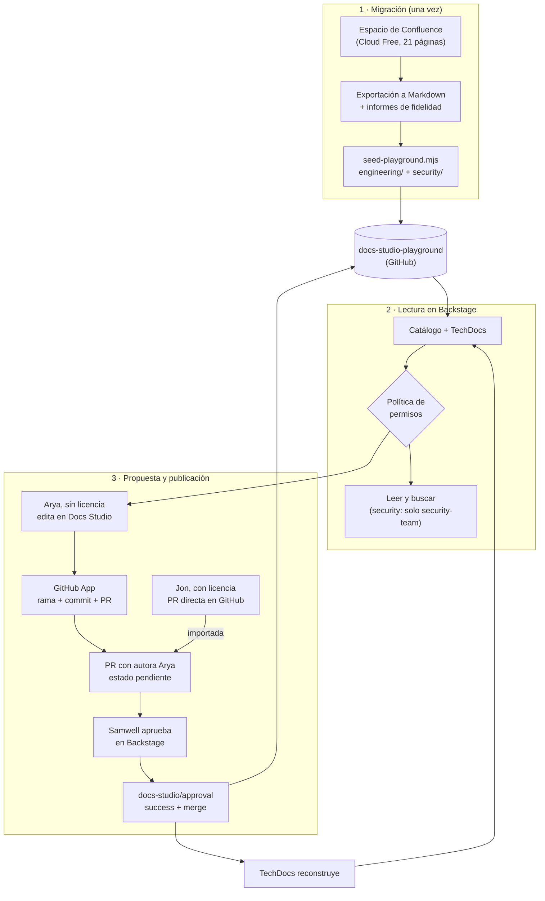

# Docs Studio: flujo de la demo de extremo a extremo

Este diagrama acompaña a la [guía de la demo](guia-demo.md). Muestra cómo el contenido va de Confluence a TechDocs y cómo viaja una propuesta de una persona sin licencia hasta publicarse.

## Cómo leerlo

- **1 · Migración** (`CF → EX → SEED → REPO`): ocurre una sola vez. La exportación no se graba.
- **2 · Lectura** (`CAT → POL → READ`): la política de Backstage oculta las entidades restringidas. En GitHub, la restricción depende de los permisos del repositorio (ver la sección 1.5 de la guía).
- **3 · Propuesta** (`EDIT → APP → PR`): la App hace el trabajo en GitHub en nombre de una persona que no tiene cuenta.
- **PR nativas** (`NATIVE → PR`): entran en el mismo flujo; el ruleset las bloquea hasta la aprobación.
- **Publicación** (`APPROVE → CHECK → REPO → BUILD`): el estado obligatorio solo lo puede publicar la App, y la App no tiene _bypass_.
